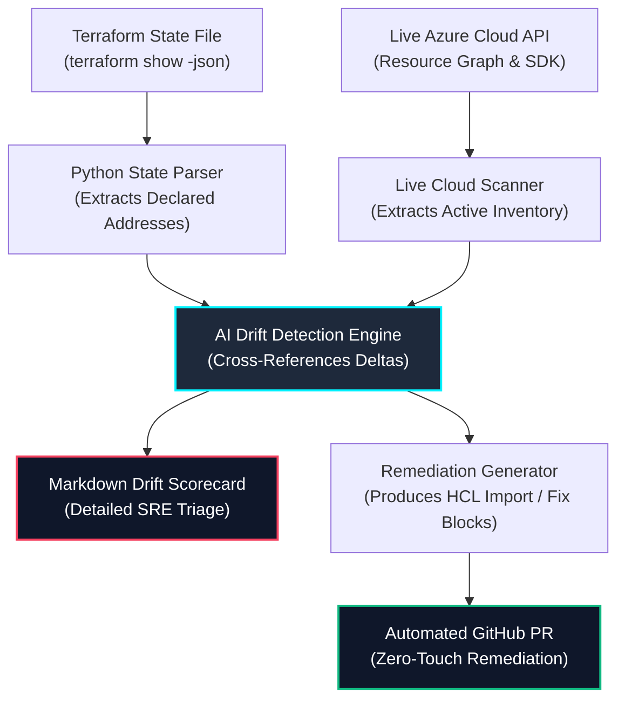

# 🤖 Intelligent Terraform Drift Detection & AI Remediation Agent

[](https://www.python.org/)
[](https://www.terraform.io/)
[](https://azure.microsoft.com/)
[](#license)

> **Autonomous AI-assisted SRE agent and Python engine that parses Terraform execution states, scans live Azure cloud inventories, detects out-of-band configuration drift, and generates corrective HCL pull requests.**

---

## 🏛️ Autonomous Drift Detection Workflow



---

## 🚀 Key Capabilities

* **Cryptographic State Parsing:** Parses deep, multi-tier JSON modules and child modules from `terraform show -json` without external CLI dependencies.
* **Out-of-Band Change Detection:** Uncovers manually opened NSG inbound rules, modified storage public access settings, or deleted private endpoints.
* **Orphaned Asset Identification:** Pinpoints unattached Azure Managed Disks, disassociated Public IPs, and idle App Service plans costing unbudgeted cloud dollars.
* **Automated Corrective HCL Blocks:** Emits ready-to-merge `import { ... }` blocks and Terraform HCL patches to bring infrastructure back into 100% compliant code synchronization.

---

## 🛠️ Usage & Installation

```bash
# Clone the repository
git clone https://github.com/kumarsumanpriya/ai-terraform-drift-agent.git
cd ai-terraform-drift-agent

# Install dependencies
pip install -r requirements.txt

# Run drift inspection CLI
python -m drift_agent.cli analyze --state-file examples/sample_tfstate.json --report-output drift_report.md

# Run test suite
pytest -v
```

---

## 👨‍💻 Author

**Kumar Suman Priya**  
*Lead DevSecOps & Cloud Platform Engineer*  
GitHub: [@kumarsumanpriya](https://github.com/kumarsumanpriya)
